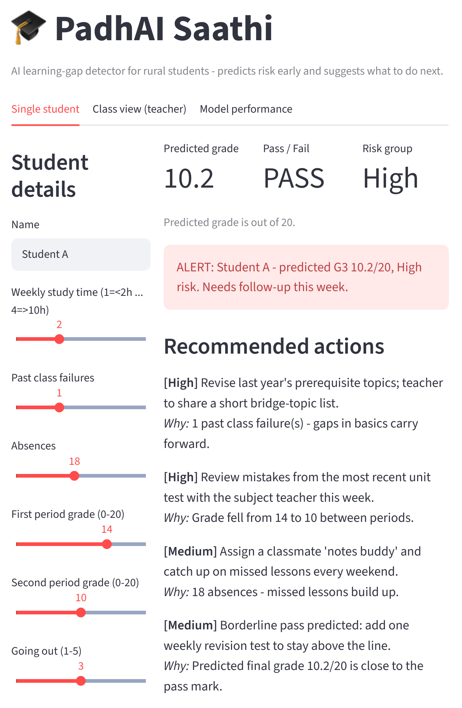
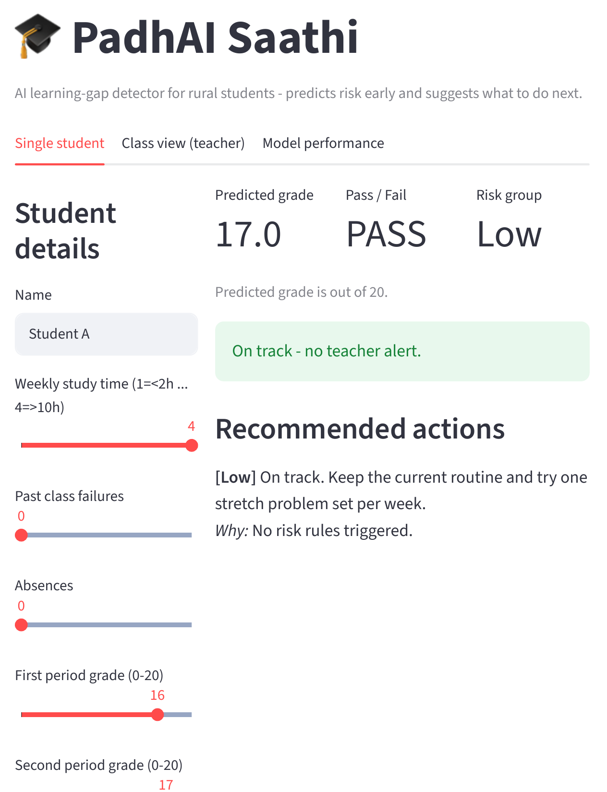
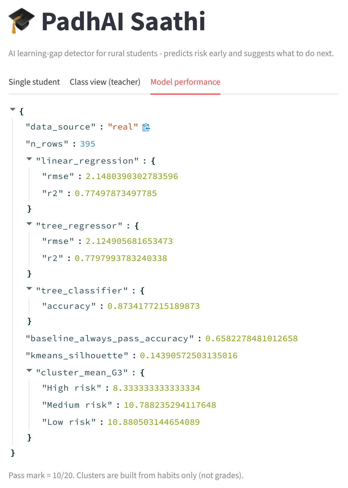
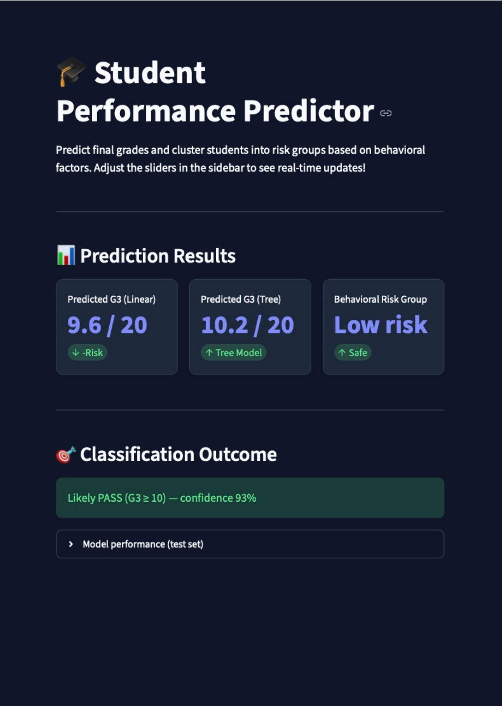
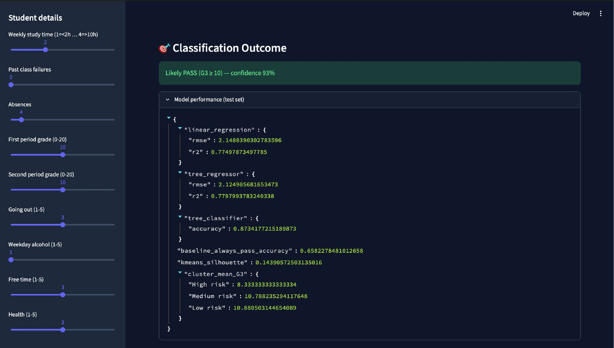

# PadhAI Saathi - AI learning-gap detector for rural students

**Author:** Pradumn Patidar, Indore Institute of Science and Technology
**Program:** AICTE x IBM SkillsBuild Machine Learning & Applied AI Internship 2026
**SDG:** 4 - Quality Education

PadhAI Saathi predicts a student's final grade, pass/fail and risk group from early marks and habits. It then turns those predictions into a prioritised action plan for the student and an alert list for the teacher.

Agent loop: **Perceive** (student data) -> **Predict** (ML models) -> **Decide** (rule-based recommender, `src/recommend.py`) -> **Act** (study plan + teacher alert). The teacher stays in control, and every recommendation shows the reason behind it.

## Screenshots

### Version 2 - at-risk student (alert + prioritised actions)


### Version 2 - on-track student (no alert)


### Model performance tab (real UCI dataset, 395 rows)


### Version 1 - first working MVP built with IBM Bob



## Dataset
UCI "Student Performance" (`student-mat.csv`, separator `;`, about 395 students). Put it in `data/student-mat.csv`.
If the file is missing the code falls back to SYNTHETIC data and the app shows a yellow warning banner. Never report metrics from synthetic data.

## Run
```
pip install -r requirements.txt
python src/train.py
streamlit run app.py
```
Check that the terminal prints "Loaded REAL dataset" during training. App tabs: single student, class view (upload a CSV shaped like `data/sample_class.csv`, which is synthetic demo data), and model performance.

## Models
| Task | Model | Metric |
|---|---|---|
| Predict final grade G3 (0-20) | Linear Regression, Decision Tree Regressor | RMSE, R2 |
| Pass/Fail (G3 >= 10) | Decision Tree Classifier (depth 4) | Accuracy vs majority baseline |
| Risk groups | K-Means (k=3) on habits only, not grades | Silhouette, mean G3 per cluster |

## Results (real dataset, 80/20 split)
- Linear Regression: RMSE 2.15, R2 0.77
- Decision Tree Regressor: RMSE 2.12, R2 0.78
- Pass/fail tree: accuracy 87.3% (majority-class baseline 65.8%)
- K-Means silhouette 0.14. Mean final grade by cluster: High 8.3, Medium 10.8, Low 10.9

## Limitations
- Small dataset from Portuguese schools; not yet tested on Indian rural data.
- Period 1 and 2 grades (G1, G2) are inputs and carry much of the predictive power. A run without them is still to do: remove `"G1", "G2"` from `FEATURES` in `src/data.py`, retrain, and compare.
- Clusters overlap (low silhouette). Medium and Low risk have almost the same average grade, so only the High group is clearly separated.
- The predicted grade (regression) and pass/fail (classifier) are separate models, so they can disagree close to the pass mark.
- Recommendations are transparent rules, not learned. The tool is decision support, not a final judgement on a student.

## How IBM Bob was used
Version 1 (screenshots above) was built with IBM Bob in VS Code.

| Step | Prompt given to Bob | What Bob produced and what I changed |
|---|---|---|
| 1 | "Write a python script to train a Linear Regression and Decision Tree Classifier to predict student performance (pass/fail)." | Bob produced `src/train.py` with the Scikit-Learn code. I modified it to add KMeans clustering for risk grouping. |
| 2 | "Create a Streamlit app to load the saved `.pkl` models and show the predictions and recommendations for students." | Bob generated the base structure of `app.py`. I changed the layout to use a sidebar and added the 'PadhAI Saathi' title and icons. |
| 3 | "Write a Python script that takes a student's data as input and suggests actionable recommendations to improve their grade." | Bob created `src/recommend.py` with basic if-else rules. I adjusted the logic to make the suggestions more relevant for our use case. |

## Project structure
```
data/             student-mat.csv (add yourself), sample_class.csv (synthetic demo)
docs/screenshots/ screenshots used in this README
models/           created by src/train.py
src/              data.py, train.py, predict.py, recommend.py
app.py            Streamlit UI
```
